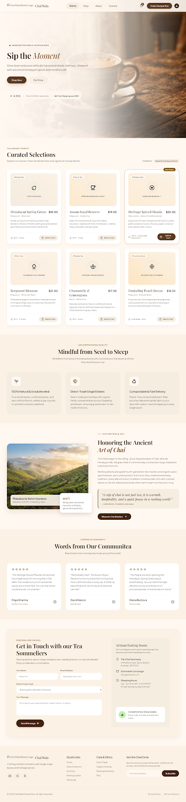

# Chai Wala — Artisanal Tea Store



> **Sip the Moment** — Slow down and savor ethically harvested whole-leaf teas, steeped with ancestral Himalayan spices and mindful craft.

## 🍵 Features

- **Artisanal Tea Selection**: Curated single-estate blends, including Signature Karak Masala, Kashmiri Kahwa Saffron, Royal Golden Assam, and Ayurvedic Tulsi Rose.
- **Interactive Tea Customizer**: Customize sweetness, milk type, spice intensity, and brew temperature.
- **Tasting Journey**: Interactive brew notes, aroma profiles, and steep timers.
- **Responsive & Modern Design**: Built with modern Tailwind CSS, fluid typography, smooth micro-interactions, and accessible UI.
- **Direct Local Server**: Ready-to-run scripts for local previewing.

## 🚀 Live Demo & Repository

- **Repository**: [https://github.com/mahnoorbaloch6780-pixel/Mahnoor-](https://github.com/mahnoorbaloch6780-pixel/Mahnoor-)
- **Live Preview via GitHub Pages**: Enable GitHub Pages in repository settings to host directly from the `main` branch.

## 💻 Local Quickstart

To run the site locally on your computer:
1. Double-click `run_localhost.bat` (or open `index.html` in any web browser).
2. Visit `http://localhost:8000` in your browser.

## 📁 Project Structure

```
├── index.html          # Main website storefront
├── code.html           # Website component source
├── DESIGN.md           # Design tokens, typography & style guidelines
├── screen.png          # Visual preview snapshot
├── run_localhost.bat   # Local test runner script
└── README.md           # Documentation
```
